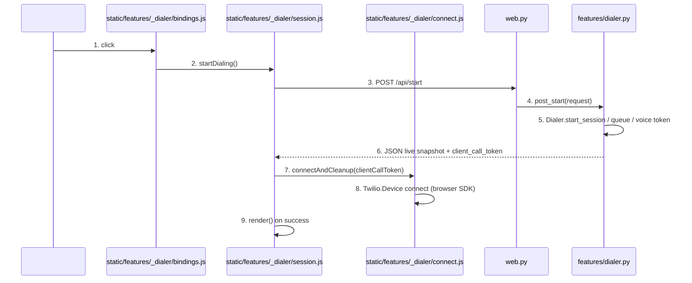
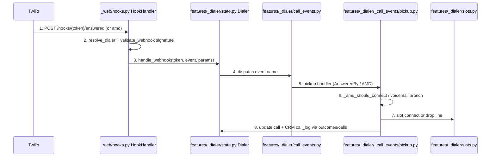
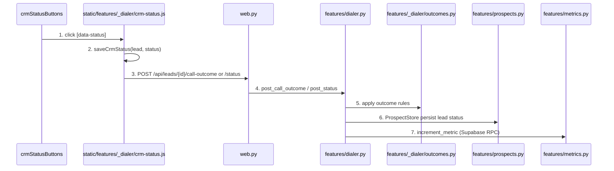
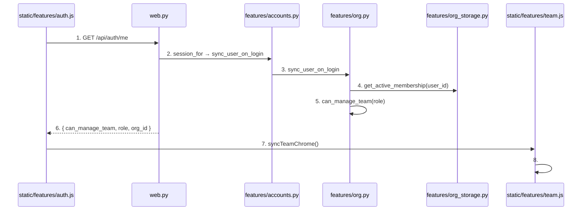
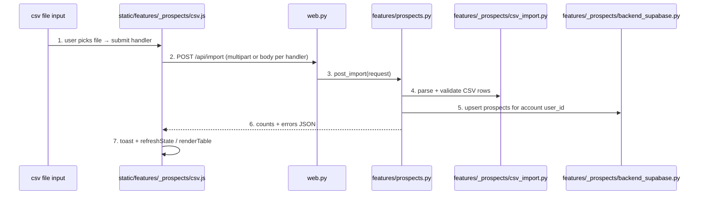

# End-to-end flow walkthroughs

Each step lists `file:function` (or DOM id → handler). Regenerate call edges with `python scripts/build_codemap.py`.

---

## 1. App startup (`python server.py` → ports open)

```mermaid
sequenceDiagram
  participant Op as Operator
  participant SP as server.py
  participant RT as features/accounts.py AppRuntime
  participant WH as _web/hooks.py
  participant WB as web.py

  Op->>SP: 1. python server.py / dialer.serve()
  SP->>SP: 2. shared/infra.enable()
  SP->>RT: 3. AppRuntime().configure()
  RT->>RT: 4. read_env + SupabaseClient.from_env (shared/_infra/supabase.py)
  RT->>RT: 5. _ping() → GET prospects (health check)
  SP->>SP: 6. maybe_start_embedded() (features/ai_media_bridge.py)
  SP->>SP: 7. ThreadingHTTPServer APP_HOST:APP_PORT → make_app_handler(runtime)
  SP->>SP: 8. ThreadingHTTPServer HOOK_HOST:HOOK_PORT → make_hook_handler(runtime)
  SP->>SP: 9. serve_forever() on app port; hook thread serve_forever()
  Note over WB: Incoming GET / handled by web.make_app_handler → respond.HandlerMixin
```

| Step | Location | What happens |
|------|----------|--------------|
| 1 | `dialer.py:serve` or `server.py` | Entry calls `serve()`. |
| 2 | `shared/infra.py:enable` | Debug logging setup. |
| 3–5 | `features/accounts.py:AppRuntime.configure` | Picks Supabase vs local JSON; stores `runtime.client`. |
| 6 | `features/ai_media_bridge.py:maybe_start_embedded` | Optional AI bridge WebSocket. |
| 7–9 | `server.py:serve` | Binds **8000** (app) and **8765** (Twilio hooks). |

---

## 2. Page load (GET `/` → `main.js` → auth → poller)

```mermaid
sequenceDiagram
  participant BR as Browser
  participant WB as web.py
  participant RS as _web/respond.py
  participant MJ as static/main.js
  participant AU as static/features/auth.js
  participant PL as static/features/_dialer/poller.js

  BR->>WB: 1. GET /
  WB->>RS: 2. send_app_page() stitches shell + feature partials
  RS->>BR: 3. HTML + vocabulary JSON inline
  BR->>MJ: 4. load main.js module graph
  MJ->>MJ: 5. bindNavigation, bindDialer, bindAuth, …
  MJ->>AU: 6. initAuth()
  AU->>WB: 7. GET /api/auth/config
  alt Google enabled
    AU->>AU: 8. supabase.createClient; getSession()
    AU->>WB: 9. GET /api/auth/me (Bearer token)
    AU->>AU: 10. refreshAccountContext → syncTeamChrome
    AU->>MJ: 11. bootApp() → refreshState
  else local mode
    AU->>MJ: bootApp without login gate
  end
  MJ->>PL: 12. startPolling()
  loop every ~1.5s
    PL->>WB: GET /api/live
    PL->>WB: GET /api/leads (if version changed)
    PL->>WB: GET /api/metrics (every 15s)
    PL->>PL: render() via registry
  end
```

| Step | Location | What happens |
|------|----------|--------------|
| 1–3 | `_web/respond.py:send_app_page` | Concatenates `static/shell.html` + feature HTML partials. |
| 7 | `web.py:get_auth_config` | Returns Supabase URL + anon key for browser auth. |
| 9 | `web.py:get_auth_me` + `features/org.py:membership_for_auth` | Org role for Team tab. |
| 12+ | `poller.js:refreshState` | Live dialer + CRM sync loop. |

---

## 3. Click Start dialing → Twilio browser leg



| Step | Location | What happens |
|------|----------|--------------|
| 1–2 | `bindings.js:bindDialer` | `dialerEl("startButton")` click → `startDialing`. |
| 3–6 | `features/dialer.py:post_start` | Starts server dialer session; issues desk token. |
| 7–8 | `connect.js` | Registers Twilio voice device with token from `/api/voice-token` path in session flow. |

---

## 4. Twilio webhook: answered → pickup → slots



| Step | Location | What happens |
|------|----------|--------------|
| 1–2 | `_web/hooks.py:dispatch` | Separate **port 8765** hook server. |
| 3 | `Dialer.handle_webhook` | Routes Twilio status to internal handlers. |
| 5–7 | `pickup.py` | Machine/human detection; connects agent or drops. |

---

## 5. Disposition click → CRM + metrics



| Step | Location | What happens |
|------|----------|--------------|
| 1–3 | `crm-status.js` | In-call disposition buttons on active lead. |
| 4–7 | `outcomes.py`, `metrics.py` | Status transitions + daily metric counters. |

---

## 6. Login → Team tab visibility



| Step | Location | What happens |
|------|----------|--------------|
| 4 | `org_storage.py:get_active_membership` | `org_members` row status=active. |
| 8 | `team.js:syncTeamChrome` | Side nav Team tab only for owner/manager. |

---

## 7. CSV import



| Step | Location | What happens |
|------|----------|--------------|
| 2 | `csv.js` | `request("/api/import", { method: "POST", … })`. |
| 3–5 | `prospects.py:post_import` | Per-user CRM storage (not org-shared). |

---

See `graph.json` `routes` and `docs/codemap/files/**` for handlers and pseudocode on every step.